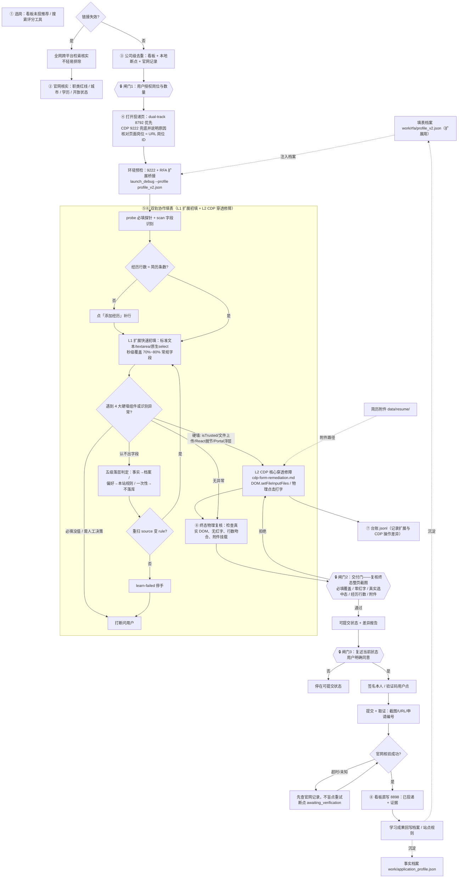

# 投递总流程（pipeline）

本文件是「选岗 → 投递 → 登记」的唯一入口图：一图 + 一表 + 三道闸门 + 人工接管点。每阶段只写做什么、用什么、真源在哪；规则本体以真源为准，本文不复述判据细节。

## 流程图

## 阶段与真源

| 阶段 | 做什么 | 工具 | 规则真源 |
|---|---|---|---|
| 0 资产 | 事实档案 / 填表档案 / 附件 | `work/application_profile.json`、`work/rfa/profile_v2.json`、`data/resume/` | 根 AGENTS.md |
| ① 选岗核实 | 候选 → 官网核实资格与红线 → 公司级去重 | 看板 `unapplied`、`work/tools/applied_index.py check <公司>` | [screening-playbook.md](screening-playbook.md)、[safety-gates.md](safety-gates.md) |
| 🔒 闸门1 | 向用户复述候选清单，拿到明确授权才填表 | 对话复述 + `work/tools/gate_log.py gate1` 留痕 | [safety-gates.md](safety-gates.md) 授权范围 |
| ② 进场 | 打开投递页，核对页面岗位 = URL 岗位 ID | `dual-track-browser-agent`（8792）；CDP 9222 兜底 | dual-track skill、[submit-playbook.md](../../auto-resume-submit/references/submit-playbook.md) |
| ③ 填表 | 双轨协作闭环：L1 扩展初填 + L2 CDP 穿透修障 | `D:\auto-delivery\resume-autofill\tools\loop.py`、`work/rfa/cdp.py`、`native_driver.py` | [cdp-form-remediation.md](cdp-form-remediation.md)、`D:\auto-delivery\resume-autofill\SELF_LEARNING_LOOP.md` |
| ④ 台账 | 每个决策一行，记录扩展与 CDP 操作差异 | `D:\auto-delivery\resume-autofill\ledger\` | SELF_LEARNING_LOOP §7 |
| 🔒 闸门2 | 复核**终态整页截图** + 四项指标（必填/红字/选中/行数/附件） | 终态截图核验 + 差异报告 | [cdp-form-remediation.md](cdp-form-remediation.md) §5、根 AGENTS.md |
| 🔒 闸门3 | 提交前复述当前状态，用户明确同意 | 对话复述 + `work/tools/gate_log.py gate3` 留痕 | 根 AGENTS.md 提交类动作铁律 |
| ⑤ 提交取证 | 一次提交 + 截图/URL/申请编号；未知先查记录 | 浏览器（签名/验证码按 safety-gates 边界） | [application-playbook.md](application-playbook.md) §5 |
| ⑥ 登记 | 官网核验成功后写看板 | `auto-resume-submit/scripts/qiuzhao_api.py`（仅 8898） | [application-playbook.md](application-playbook.md) §6、[看板API手册.md](../../auto-resume-submit/references/看板API手册.md) |
| 飞轮 | 落层学习成果回写档案 / 站点规则 | `patchProfile` / `learn` / `addField` | SELF_LEARNING_LOOP §4 |

断点文件约定为 `work/ckpt_<公司>.json`，契约 `work/ckpt.schema.json`（6 态词表 + 键别名），
校验/归一并生成接管清单：`python work/tools/ckpt_lint.py [--migrate|--handoff]`。
本地断点承载所有中间状态，看板只收核验成功的「已投递」。

## 三个必须记住的工具

| 工具 | 何时跑 | 产出 |
|---|---|---|
| `python work/tools/gate_log.py gate1 --companies "A,B" --count 2 --quote "<用户原话>"` | 拿到授权那一刻 | `work/gates.jsonl` 一行；无此记录时 `gate3` 会拒绝 |
| `loop.py gate --review r.json` | 填完、冷启动复验通过后截图 | 台账 `delivered`/`rejected`/`overridden`；退出码 0/2/3 |
| `python work/tools/gate_log.py gate3 --ckpt work/ckpt_X.json --quote "确认提交"` | 提交前 | `work/gates.jsonl` 一行；再执行唯一一次提交 |

档案三源（事实 `application_profile.json` / 填表 `rfa/profile_v2.json` / 扩展运行态）：
改了 `profile_v2.json` **必须重跑** `launch_debug --profile work/rfa/profile_v2.json`，
否则 `rowPlan` 用旧数据。检查：`python work/tools/profile_sync.py check`。
去重索引：`python work/tools/applied_index.py build`（看板+断点，只读）→ `check <公司>`。

## 人工接管点

| 情形 | 处理 |
|---|---|
| 三道闸门 | 授权 / 交付验收 / 提交，全部用户决策，机器不得代行；闸门 1/3 各写一行 `work/gates.jsonl` |
| 交付门被拒但用户要推进 | `loop.py gate --override-by user --override-reason "..."` → 台账 `overridden`（不算过门，报告必须写明未满足项） |
| 跨 iframe / Shadow DOM 的必填 | RFA 不穿透，人工填（SELF_LEARNING_LOOP §9） |
| 只读日历控件（Wdate 类） | 硬写会被判格式错，人工 |
| 滑块拼图 / 短信码 / 字符图形码 | 用户本人操作（点选型可按 safety-gates「验证码边界」由 agent 可信点击 + 截图核对） |
| `missing-required` / `learn-failed` / `row-gap` | 停手问用户或阻断交付，不带病提交（SELF_LEARNING_LOOP §5） |
| 刷新后页面自带草稿（`COLD_START_NOT_EMPTY`） | 这一屏的值归因不到扩展：换干净申请 / 显式清空后重跑 / 如实记录「该站无法用截图证明扩展能力」，**不许截图冒充** |
| 刷新后经历被折回一行（冷启动 `ROW_GAP`） | 扩展不点「添加」：补行后重跑冷启动；补不上就阻断交付 |
| 一批多家停在人工点 | 先 `ckpt_lint.py --handoff` 生成 `work/pending_human.json`，一次交给用户处理完再继续 |

## 新站点首跑（非北森 zhiye）

RFA 扩展按通用中文网申设计（`<all_urls>` 注入），但实战回填目前只有 zhiye.com 站族；牛客 / Moka / 飞书 / 51job / 国聘 / 自建站首跑时：

1. 先 `loop.py --dry-run` + `probe` + `rows` 看识别率与行覆盖，不假设开箱命中；
2. 认不出的字段按 SELF_LEARNING_LOOP §4 落层，扩展写不进的控件走可信 CDP 兜底；
3. 首跑结论（站点规则、别名、坑）记入台账，供下次复用。
